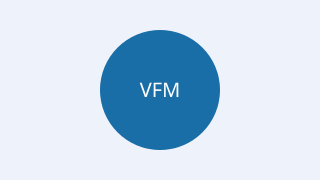

# How to use this tutorial {#sec:howto}

You do not need a slide program to make slides with VFM. You write Markdown, mark the parts that belong on slides, and switch the preview from **document** to **slides**. This tutorial teaches that, one idea at a time, and every idea comes with a complete deck in the folder [`slides/`](slides/) that you can open, run and change.

1. Open a deck, for example `slides/01-first-slides.md`, in VS Code with the VFM Preview extension.
2. Open the preview beside it (⌘K V) and switch to slides (⌘K M). Press ← and → (or Space) to move, **T** to show or hide the thumbnails, **F** for full screen.
3. Change something in the file and watch the slide change. Double-click a slide to jump to the line that made it, and press ⌘K J in the editor to jump the other way.
4. Open the Problems panel: VFM tells you about anything it dropped or could not fit, with a code, a file and a line (see [@sec:codes]).

> [!TIP]
> This tutorial assumes you know the basics of Markdown. If you do not, start with `TUTORIAL.md` in this folder, which teaches Markdown and everything else in VFM's flavor; come back here afterwards.

The decks are numbered in the order they are taught:

| Deck | It teaches |
| --- | --- |
| [`01-first-slides.md`](slides/01-first-slides.md) | the smallest working deck, the title slide, a lead-in |
| [`02-titles-and-sections.md`](slides/02-titles-and-sections.md) | where a slide's title comes from, dividers and agendas |
| [`03-layouts.md`](slides/03-layouts.md) | text beside a picture, two columns, tables |
| [`04-reveal-steps.md`](slides/04-reveal-steps.md) | showing a list one item at a time |
| [`05-paragraphs.md`](slides/05-paragraphs.md) | how whole paragraphs become slide text |
| [`06-figures-tables-and-references.md`](slides/06-figures-tables-and-references.md) | numbered figures, tables and equations, and what happens to a reference |
| [`07-citations-notes-footnotes.md`](slides/07-citations-notes-footnotes.md) | citations, presenter notes, footnotes |
| [`08-colors-and-cover.md`](slides/08-colors-and-cover.md) | theme colors, a cover image, authors and affiliations |
| [`09-math-diagrams-code.md`](slides/09-math-diagrams-code.md) | math, diagrams, algorithms, music, code |
| [`10-includes.md`](slides/10-includes.md) | splitting a deck across files |
| [`11-a-whole-talk.md`](slides/11-a-whole-talk.md) | a complete talk that uses all of it |

# The idea: one file, two views {#sec:idea}

A VFM file is a document. Wrap some of its blocks in `@slide … @end` and the same file is also a slideshow.

- In **document mode** the `@slide` and `@end` lines vanish and everything is shown, as in any Markdown preview.
- In **slide mode** only what is inside `@slide … @end` is shown, split across as many 1280×720 slides as it takes. Everything else is skipped, so you can keep prose, figures and notes-to-self in the file without them reaching the audience.

````markdown
# Why slides from Markdown

This paragraph is outside every block, so slide mode skips it.

@slide
- One file for the page and for the talk
- You edit text, not slide masters
@end(The same file reads as a document.)
````

Three things to notice:

1. `@slide` and `@end` sit on lines of their own. The opener is on **one line**, with no space before any `[` or `(`.
2. The slide is titled **Why slides from Markdown**, taken from the heading above the block.
3. The text in parentheses after `@end` is the **lead-in**: a line shown at the bottom of the last slide of the block, and nowhere in the document.

A block holds whole blocks of Markdown: paragraphs, lists, headings, tables, figures, code, math. It cannot cut a paragraph or a list in two. When too much is inside, VFM continues on another slide and repeats the title with a counter, `(1/2)`, `(2/2)`.

## Deck 1: the smallest deck {#sec:deck1}

Open `slides/01-first-slides.md`. It has a YAML header (`title`, `subtitle`, `authors`, `date`), which gives you a **title slide** for free, and two blocks. What you get:

| Slide | Where it comes from |
| --- | --- |
| 1 | the title slide, made from the header |
| 2 | "Why slides from Markdown": the heading before the block; the lead-in is at the bottom |
| 3 | "What to try next": the title in `[square brackets]` after `@slide` |

Try these changes:

- Delete the YAML header. The title slide disappears; the other slides stay.
- Add `@end(Questions?)` to the last block and look at the bottom of the slide.
- Add a third `@slide` of your own, with a numbered list.

# Titles and sections {#sec:titles}

A slide's title is decided in this order:

1. the `[title]` you write after `@slide`, if any (`[]` means a blank title on purpose);
2. otherwise the nearest heading above the block;
3. otherwise no title. That is not an error.

````markdown
# Methods

@slide
- Sample 40 documents
@end

@slide[A title of your own]
- The brackets override the heading
@end

@slide[]
- Empty brackets: a blank title on purpose
@end
````

Open `slides/02-titles-and-sections.md` for the whole picture, including these special blocks:

- A block whose content is **only headings** is a *divider*. Next to other dividers it merges into one **agenda slide**, with the headings as a nested list. Three blocks, each with one heading, give one slide with three entries.
- A block with a title and **nothing inside**, `@slide[Thank you]` followed by `@end`, is a **title-only slide**: one large title. It never merges into an agenda.
- A block with a `[title]` and only headings keeps its title and shows the headings as a list (an agenda you name yourself).

> [!NOTE]
> Adjacent blocks merge only when they are plain dividers. Three blocks that each have the same `[Agenda]` title stay three slides. To get one agenda slide, write one block with three headings, as `slides/parts/agenda.md` does.

Headings *inside* a block become sections of the slide. The shallowest heading inside is the first level beneath the slide's title. A heading and the block after it always stay together, so a heading is never left alone at the bottom of a slide.

# Layouts {#sec:layouts}

The option list in parentheses after `@slide` chooses how the slide is laid out. Several options can be given, in any order.

| Option | Result |
| --- | --- |
| *(none)* | one column |
| `rtext` | text on the right, pictures on the left |
| `ltext` | text on the left, pictures on the right |
| `2col` | two balanced columns |

````markdown
@slide[Picture on the left](rtext)
- `rtext` puts the text on the right
- and the picture on the left


@end
````

Open `slides/03-layouts.md` and look at its five slides: a picture beside text in both orders, two columns of text, two pictures side by side (each gets its own column), and a table that fills the slide.

Some rules worth knowing:

- `rtext` and `ltext` only matter when the slide has a picture. Without one they give a single column (VFM tells you with `layout-no-image`).
- `2col` with one picture falls back to one column for that slide. With two pictures and no text, each picture gets a column.
- A picture is an image alone in its paragraph. An image in the middle of a sentence stays in the sentence.
- Pictures and videos shrink to fit their place and keep their proportions. Tables use slightly smaller text and shrink further to fit; a table that is still too tall is split across slides by rows, with its header repeated.
- A slide holds at most one *float* (a table, a code listing, a theorem, an algorithm, a score or a diagram) next to its text; another one goes on the next slide.

# Revealing a list step by step {#sec:steps}

Two options control what appears when you press →:

- `steplists` shows the items of every list one at a time, in reading order. A nested item appears after its parent.
- `stepleadin` shows the lead-in only at the end, after the last list item.

````markdown
@slide[The lead-in comes last](steplists, stepleadin)
- Collect the data
- Fit the model
- Check the residuals
@end(That is the whole method.)
````

Open `slides/04-reveal-steps.md`. Hidden items keep their space, so nothing jumps around as they appear. Slides without these options show everything at once. In the PDF export, every slide shows its final step.

# From paragraphs to slide text {#sec:paragraphs}

You can write whole paragraphs inside a block. VFM then makes slide text from them by **selecting and deleting sentences, never rewriting**. That keeps every word on the slide yours, and keeps the rest of the paragraph in the file.

The rule that makes this work: **write one sentence per line.** A sentence ends at sentence-ending punctuation followed by a line break; nothing else counts as a boundary, so `Dr. Chen` is never cut and no language needs a special list.

What happens to a paragraph depends on its shape (open `slides/05-paragraphs.md`):

| You write | The slide shows |
| --- | --- |
| a long paragraph | the two most telling sentences (first, last, bold, numbers, words shared with the title) |
| a paragraph that is only bold | all of it, as written |
| sentences that start with *First,* *Second,* *Third,* (or `1.`) | a numbered list |
| `A sentence that introduces: a, b, and c.` | one bullet with `a`, `b` and `c` nested beneath |
| one sentence around a number, percentage or price | a callout |
| a `---` line between two parts | the slide ends there and a new one starts (no repeated heading) |

````markdown
@slide[Ordinals become a numbered list]
First, write one sentence per line.
Second, bold the sentences that matter.
Third, preview the slides.
@end
````

Two ways to take control:

- **Bold the sentences that matter.** Bold text scores high, so it is kept.
- **Set the mode** in the YAML header: `paragraphs: full` keeps every paragraph whole; `first-sentence` keeps only the first sentence; `notes-only` keeps no paragraph text (a block that holds only paragraphs then gives no slide and VFM reports `drop-all`); the default is `auto`. Set `lang:` for another language (English is the default).

# Figures, tables, equations and what happens to a reference {#sec:xrefs}

Everything you learned about labels works on slides: `{#fig:name}`, `{#tab:name}`, `{#eq:name}` and `[@fig:name]`. On slides there is one extra rule, because a reference to something on another slide would point nowhere:

> A cross-reference survives only if what it points to is **on the same slide**.

A sentence or list item whose reference would dangle is dropped, and VFM says so in the Problems panel (`drop-xref`, and `drop-follows`, which points at the sentence after the drop, since it might begin "This…" and no longer make sense). A reference to a label that exists nowhere in the file is a mistake and is an error.

````markdown
@slide[A figure with its reference](rtext)
Figure [@fig:disc] shows the disc.

 {#fig:disc}
@end
````

Open `slides/06-figures-tables-and-references.md` for six slides:

1. a figure and the sentence that cites it: both stay;
2. a sentence citing that figure from another slide: the sentence is dropped, the one beside it stays;
3. a table with a caption (the paragraph touching the table, with its label);
4. `noxrefs`, which drops **every** sentence that holds a reference, even one that could resolve;
5. an equation that is numbered because a reference on the slide points at it;
6. a block with `nodoc`, which is in the slides but left out of the document.

Numbers are assigned only to things that a surviving reference points to, and they count 1, 2, 3 across the deck with no gaps. Everything else shows only its caption.

# Citations, notes and footnotes {#sec:cite}

Open `slides/07-citations-notes-footnotes.md`.

- **Citations.** `@cite(key)` works as in the document. The option `showrefs` lists on each slide the references cited **on that slide** that no earlier slide has already shown, so a long reference list never builds up on one slide. A citation inside a `[title]` or an `@end(lead-in)` is an error.
- **Presenter notes.** `@note(text)` on a line of its own inside a block is a note for the speaker. It belongs to the slide that holds the content right before it, may run over several lines and holds inline Markdown. It never appears in the document, the audience's slide or the PDF; it appears in the notes panel (**N**) and the presenter window.
- **Footnotes.** A footnote is shown on a slide only when it is defined **inside that slide's block**, and it is numbered from 1 on that slide. One defined outside the block still works in the document, but slide mode warns (`unknown-footnote`).

````markdown
@slide[A footnote on a slide]
- A claim that needs a note[^one]

[^one]: Defined between the opener and `@end`.
@end
````

# Colors, a cover and authors {#sec:colors}

These keys in the YAML header style the whole deck. Open `slides/08-colors-and-cover.md`.

| Key | Effect |
| --- | --- |
| `theme-color: "#1a6ea8"` | the rule under every title, and the background of the title slide and of section slides, as written, with light or dark text chosen for contrast |
| `separator-color` | the rule under titles on its own, when it should differ from `theme-color` |
| `section-color` | the background of section slides on its own |
| `title-image: cover.svg` | a picture behind the title slide, under a dark layer so the text stays readable |
| `authors`, `affiliations` | names with numbered affiliations on the title slide |

A color can be `#rgb`, `#rrggbb`, `rgb()`, `hsl()` or a CSS name. An invalid one is reported and ignored. A *section slide* is a title-only block or a divider.

# Math, diagrams, algorithms, music and code {#sec:drawn}

These need nothing special: write them as in a document. Each is a float, so give each slide one. Open `slides/09-math-diagrams-code.md` for a slide of each kind: display math, a Mermaid diagram, an algorithm, a score with a Play button and a code listing.

A float that is too tall for its place shrinks, down to half size; one that is still too tall is left off the slide with a hint in the Problems panel (`drop-float`). In that case shorten it or give it a slide of its own.

# Splitting a deck across files {#sec:include}

A line holding only `@include(path)` is replaced by that file before anything is parsed. Paths are relative to the file that includes them, files may include files, and a cycle is reported. Diagnostics name the original file and line.

````markdown
@slide[In the main file]
- Text here
@end

@include(parts/agenda.md)
````

Open `slides/10-includes.md`, which includes `parts/agenda.md` and `parts/closing.md`. Use this to keep a long talk in one file per section, or to share an agenda between talks.

# A whole talk {#sec:talk}

`slides/11-a-whole-talk.md` puts it together in eight slides: a title slide from the header, a stepped list with a lead-in and a speaker note, an agenda made from headings, a paragraph reduced to its best sentences, a picture beside stepped text, a table with a caption, a result with a callout and a citation, and a summary. Read it from the top; every block is short, because a block that fits on a slide needs no splitting.

## A recipe for turning a paper into a talk

1. **Keep the paper's headings.** They become slide titles.
2. **Wrap, do not copy.** Put `@slide … @end` around the paragraphs, lists and figures that belong in the talk. The paper stays whole in document mode.
3. **Write one sentence per line** in the paragraphs you wrap, and bold the sentence you cannot lose.
4. **Add `@note(…)`** where you want a reminder to say something the slide does not.
5. **Look at the Problems panel.** Each `drop-xref` is a sentence whose figure is on another slide. Move the figure into the same block, or accept the drop.
6. **Add options last:** `steplists` where you build an argument, `rtext` where a picture carries the point, `theme-color` for the look.

# Reference {#sec:reference}

## The opener and the closer

````markdown
@slide[Title override](layout, showrefs, nodoc, noxrefs, steplists, stepleadin)
  …blocks, headings allowed…
@end(Lead-in shown on the last slide of the block)
````

| Part | Rules |
| --- | --- |
| `[Title]` | optional, inline Markdown, overrides the heading; `[]` is blank; no `@cite` or footnote inside; write `\]` for a bracket |
| `(options)` | `rtext`, `ltext`, `2col`, `showrefs`, `nodoc`, `noxrefs`, `steplists`, `stepleadin`; an unknown option is an error in both modes |
| `@end(Lead-in)` | optional, inline Markdown, balanced parentheses (`\)` to escape) |
| `@note(Text)` | inside a block, on its own line; presenter-only |
| `---` | inside a block, ends the slide |
| `@include(path)` | on its own line, splices a file in |

## What VFM tells you {#sec:codes}

| Code | Meaning | What to do |
| --- | --- | --- |
| `syntax` | an unbalanced `@end`, an unknown option, a directive in the middle of a line | fix the line it names |
| `unknown-label` | `[@x]` names a label that exists nowhere | fix the label or add it |
| `overflow` | one sentence or block is taller than a slide | shorten it, or split the sentence |
| `drop-xref`, `drop-follows` | a sentence was dropped because its target is on another slide | move the target into the block, or accept it |
| `drop-float` | a float did not fit and was left off | shorten it or give it its own slide |
| `drop-all` | a whole paragraph or list disappeared | check its references |
| `too-many-headings` | a content slide holds more than two headings | split the block |
| `layout-no-image` | `rtext` or `ltext` with no picture | add a picture or drop the option |
| `layout-ignored` | a layout on a divider or an agenda | remove it |
| `step-noop` | `steplists` with no list, or `stepleadin` with no lead-in | remove the option |
| `split` | a block continued onto more slides | nothing; it is information |

# Questions and answers {#sec:faq}

**Why is my paragraph shorter on the slide than in the file?**
That is the reducer: it keeps the best sentences and never rewrites. Write one sentence per line, bold what you must keep, or set `paragraphs: full` in the header.

**Why did a sentence disappear?**
It held a reference such as `[@fig:x]` whose target is on another slide. Look for `drop-xref` in the Problems panel and move the figure into the same block.

**Why are my three `@slide[Agenda]` blocks three slides?**
Only plain dividers merge. Write one block with the three headings.

**Can I have different slides in the talk and in the paper?**
Yes. Use `nodoc` for a block that should be only a slide; the rest of the file is the paper.

**How do I get a PDF or a PowerPoint file?**
In VS Code run **VFM: Export to PDF…** (one 1280×720 page per slide, every reveal step shown) or **VFM: Export Slides to PowerPoint…** (and **Export Slides as Markdown…** to get one clean block per slide).

**Where do I see my notes while presenting?**
Press **N** for the notes panel; in an exported HTML file press **P** for a presenter window that follows the audience's slide.

**Can I use my own template?**
For Word and PowerPoint export, name a template in the header: `docx-template: file.dotx`, `pptx-template: file.potx`.

# Exercises {#sec:exercises}

1. Take `slides/01-first-slides.md`, add a header `theme-color: "#8a1c7c"`, and see what changes. Which slides are colored, and which are not?
2. In `slides/06-figures-tables-and-references.md`, move the figure into the block that mentions it from afar. What happens to the `drop-xref` message?
3. Write a block of five sentences, one per line, and change `paragraphs:` to each of its four values.
4. Write a talk about a paper you know: a title slide, an agenda made of three headings, one picture with `rtext`, one stepped list with a lead-in, and one `@note` on each slide.
5. Make `slides/11-a-whole-talk.md` two files with `@include`.
