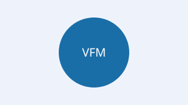
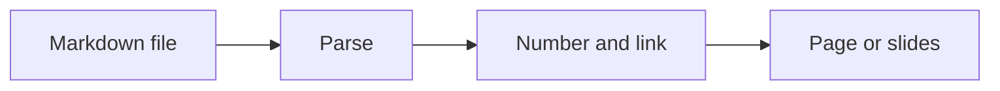

# How to use this tutorial

This file is written in **VFM** ("flavored Markdown"), and it is shown by VFM. That gives you two ways to learn from it at once.

1. **Read the page.** Every example is shown twice: first the text you write (in a gray box), then what it turns into.
2. **Read the file.** Open `TUTORIAL.md` in an editor next to the preview. Change a line, and the page changes. In the VS Code extension, double-click anything in the preview to jump to the line that made it, and press ⌘K J (Ctrl+K J) in the editor to jump the other way.

If you have never used Markdown, start at the top and go on. If you know Markdown already, jump to [@sec:added], which is about what is new.

> [!TIP]
> Markdown is a way of writing plain text so that it can also be read as a formatted page. Nothing here needs a special program to *write*: any text editor will do. A program like VFM only needs to *show* it.

The examples are written between lines of four backticks. A gray box with **markdown** in its corner is what you type. The text that follows it is the result.

## Where Markdown comes from

John Gruber invented Markdown in 2004 so that people could write for the web without writing HTML @cite(gruber2004markdown). Its rules were loose, so different programs disagreed. **CommonMark** wrote the rules down exactly @cite(macfarlane2024commonmark), and **GitHub Flavored Markdown (GFM)** added tables, task lists, strikethrough and automatic links on top of that. VFM is CommonMark plus GFM plus the things technical writing needs: numbered figures, equations, theorems, citations, notes and slides.

# The basics

## Paragraphs and line breaks

A paragraph is one or more lines of text. A blank line starts a new paragraph.

````markdown
This is the first paragraph. It continues on this line,
and a single line break inside it is just a space.

This is the second paragraph.
````

This is the first paragraph. It continues on this line,
and a single line break inside it is just a space.

This is the second paragraph.

To force a line break *inside* a paragraph, end the line with a backslash or with two spaces:

````markdown
Roses are red,\
Violets are blue.
````

Roses are red,\
Violets are blue.

> [!NOTE]
> In slides, VFM treats **a line break after a sentence as the end of that sentence**. Writing one sentence per line is therefore a good habit, and in a document it makes no difference to what readers see. See [@sec:slides].

## Emphasis

````markdown
*Italic* or _italic_.
**Bold** or __bold__.
***Both*** at once.
~~Strikethrough~~ with two tildes.
````

*Italic* or _italic_.
**Bold** or __bold__.
***Both*** at once.
~~Strikethrough~~ with two tildes.

Underscores inside a word do not mean anything, so `snake_case_names` are safe, but `*` works inside words: un*frigging*believable.

## Headings

One to six `#` characters, then a space, make a heading. The number of `#` is the level.

````markdown
# Heading level 1
## Heading level 2
### Heading level 3
#### Heading level 4
````

An older style underlines a line with `===` or `---`:

````markdown
Heading level 1
===============

Heading level 2
---------------
````

Headings give the page its outline and, in VFM, its section numbers. A heading needs a space after the `#`s, and a line starting with `#hashtag` is just text.

## Lists

````markdown
- Apples
- Oranges
  - Navel
  - Blood
- Pears

1. First
2. Second
3. Third
````

- Apples
- Oranges
  - Navel
  - Blood
- Pears

1. First
2. Second
3. Third

Numbers in an ordered list only matter for the first one. `1. 1. 1.` is shown as 1, 2, 3, and `5. 6.` starts at five. Indent a nested list by two or more spaces (to line up with the text of the parent item).

A **loose** list (a blank line between any two items) wraps every item in a paragraph; a **tight** list does not. Two lists need something between them, such as a paragraph, to be two lists:

````markdown
- Tight item one
- Tight item two

A paragraph ends the first list.

- Loose item one

- Loose item two
````

- Tight item one
- Tight item two

A paragraph ends the first list.

- Loose item one

- Loose item two

### Task lists

````markdown
- [x] Write the tutorial
- [x] Check the examples
- [ ] Teach someone else
````

- [x] Write the tutorial
- [x] Check the examples
- [ ] Teach someone else

In the VS Code preview, clicking a checkbox edits the file: `[ ]` becomes `[x]` and back.

## Block quotes

````markdown
> Programs must be written for people to read,
> and only incidentally for machines to execute.
>
> > Quotes can be nested.
````

> Programs must be written for people to read,
> and only incidentally for machines to execute.
>
> > Quotes can be nested.

## Code

Inline code goes between single backticks: `x = x + 1`. To show a backtick, use more of them as the fence: `` `tick` ``.

A code block is fenced with three backticks (or three tildes). Put the language after the opening fence and the code is colored:

`````markdown
```python
def greet(name):
    return f"Hello, {name}!"
```
`````

```python
def greet(name):
    return f"Hello, {name}!"
```

A fence ends at a line of the same character that is at least as long as the opening one, which is why the examples in this tutorial use four or five backticks: so that they can contain a three-backtick block. Lines indented by four spaces are also code, but fences are clearer.

## Links

````markdown
An [inline link](https://commonmark.org "optional title").
A [reference link][cm], defined elsewhere.
A bare address: <https://commonmark.org>, and https://github.github.com/gfm too.

[cm]: https://commonmark.org
````

An [inline link](https://commonmark.org "optional title").
A [reference link][cm], defined elsewhere.
A bare address: <https://commonmark.org>, and https://github.github.com/gfm too.

[cm]: https://commonmark.org

A link to another file next to this one opens it in the editor (in the VS Code preview).

To link to a heading, give the heading a label and refer to it. VFM writes the section number for you:

````markdown
## A heading with a label {#sec:demo}

Later in the file: see [@sec:demo].
````

## A heading with a label {#sec:demo}

Later in the file: see [@sec:demo].

Labels are explained in full under [@sec:labels]. (This tutorial links the same way, for example to [@sec:added].)

## Images

````markdown

````


The text in square brackets is the *alt text*: what a screen reader says, and what shows if the file is missing. VFM also uses it as the figure's caption (see [@sec:labels]).

## Horizontal rules, escapes and tables

Three or more `-`, `*` or `_` on a line draw a rule:

````markdown
Above

---

Below
````

Above

---

Below

A backslash makes a special character ordinary: \*not italic\*, \# not a heading, 1\. not a list.

### Tables

````markdown
| Fruit  | Count | Note       |
| ------ | :---: | ---------: |
| Apple  |   3   | crunchy    |
| Orange |  12   | juicy      |
| Pear   |   0   | out of stock |
````

| Fruit  | Count | Note       |
| ------ | :---: | ---------: |
| Apple  |   3   | crunchy    |
| Orange |  12   | juicy      |
| Pear   |   0   | out of stock |

Colons in the line under the header set alignment: `:---` left, `:---:` centered, `---:` right. The columns need not line up in the file, only in your head. Put a backslash before a `|` that belongs in a cell, and write the cell's text with any inline Markdown you like (**bold**, `code`, links).

### Footnotes

````markdown
Markdown has a long history.[^history] Footnotes can be named anything.[^any-name]

[^history]: It began in 2004.
[^any-name]: Readers see them numbered in order of use.
````

Markdown has a long history.[^history] Footnotes can be named anything.[^any-name]

[^history]: It began in 2004.
[^any-name]: Readers see them numbered in order of use.

# Cheat sheet for the basics

| You want | You write |
| --- | --- |
| *italic*, **bold** | `*italic*`, `**bold**` |
| a heading | `# Title`, `## Section` |
| a bullet, a number | `- item`, `1. item` |
| a checkbox | `- [ ] todo`, `- [x] done` |
| a quote | `> text` |
| code | `` `code` `` or a fenced block |
| a link, an image | `[text](url)`, `` |
| a table | pipes and a `---` line |
| a footnote | `text[^id]` and `[^id]: note` |
| a literal special character | a backslash before it |

# What VFM adds {#sec:added}

Everything above works in any CommonMark/GFM program. Everything from here on is VFM's own, and it is the reason to use it for papers, reports and talks.

## Underline, highlight, subscript and superscript

````markdown
~Underlined~ text (one tilde) and ~~struck~~ text (two).
Some ==highlighted words== to catch the eye.
Water is H_{2}O, and E = mc^{2}, and x^{2}. Powers of ten: 10^{-3}. Nesting works: a^{b_{c}}.
````

~Underlined~ text (one tilde) and ~~struck~~ text (two).
Some ==highlighted words== to catch the eye.
Water is H_{2}O, and E = mc^{2}, and x^{2}. Powers of ten: 10^{-3}. Nesting works: a^{b_{c}}.

A single tilde pair needs text touching both tildes, so "about ~5 to ~10" stays as written. Sub- and superscripts use braces so that `[^1]` can stay a footnote; a pair must close on the same line. Between `==` marks the text is shown as written (emphasis inside highlighted text is not interpreted).

## Alerts

````markdown
> [!NOTE]
> Useful information the reader should see.

> [!TIP]
> A helpful hint.

> [!IMPORTANT]
> Something that must not be missed.

> [!WARNING]
> Something that can go wrong.

> [!CAUTION]
> Something that can do damage.
````

> [!NOTE]
> Useful information the reader should see.

> [!TIP]
> A helpful hint.

> [!IMPORTANT]
> Something that must not be missed.

> [!WARNING]
> Something that can go wrong.

> [!CAUTION]
> Something that can do damage.

The marker must be alone on the first line. `[!SOMETHING]` of another name, or text after the marker, leaves an ordinary quote.

## Math

Wrap TeX in single dollar signs for math inside a sentence, in double dollar signs on their own lines for a displayed equation. VFM draws it with KaTeX.

````markdown
The area of a circle is $A = \pi r^2$, and

$$
\int_0^\infty e^{-x^2}\,dx = \frac{\sqrt{\pi}}{2}
$$
````

The area of a circle is $A = \pi r^2$, and

$$
\int_0^\infty e^{-x^2}\,dx = \frac{\sqrt{\pi}}{2}
$$

A dollar sign that never finds its partner is just a dollar sign: it costs $5 today. Math is not interpreted inside code: `$x$`.

## Figures, tables, listings and equations {#sec:labels}

Give something a **label** with `{#kind:name}`, and VFM numbers it. Then refer to it with `[@kind:name]` and the number appears as a link, wherever the label is in the document, even later.

| Kind | Label starts with | What it labels |
| --- | --- | --- |
| Figure | `{#fig:…}` | an image on its own line, or a diagram |
| Table | `{#tab:…}` | the caption line directly above a table |
| Listing | `{#lst:…}` | a fenced code block, in its info string |
| Equation | `{#eq:…}` | a display math block, or one of its lines |
| Section | `{#sec:…}` | a heading |
| Algorithm | `{#alg:…}` | an algorithm block |
| Score | `{#mus:…}` | a music block |

### Figures

````markdown
 {#fig:disc}

[@fig:disc] shows the disc.
````

 {#fig:disc}

[@fig:disc] shows the disc.

The alt text becomes the caption. An image that is alone in its paragraph is a figure; the image and its label go on one line.

### Table captions {#sec:table-captions}

A paragraph that **touches** the table (no blank line between) is the table's caption. Put the label at the end of it.

````markdown
Fruit sold per day. {#tab:fruit}
| Fruit  | Sold |
| ------ | ---: |
| Apple  |   30 |
| Orange |   12 |

[@tab:fruit] lists what was sold.
````

Fruit sold per day. {#tab:fruit}
| Fruit  | Sold |
| ------ | ---: |
| Apple  |   30 |
| Orange |   12 |

[@tab:fruit] lists what was sold.

> [!IMPORTANT]
> This is the one place where VFM reads a blank line differently from other Markdown programs. Leave a blank line between a paragraph and a table when you do *not* want the paragraph to become a caption.

### Listings

Add a caption and a label after the language, in the opening fence:

`````markdown
```python Count the vowels in a string. {#lst:vowels}
def vowels(s):
    return sum(c in "aeiou" for c in s.lower())
```

[@lst:vowels] is short.
`````

```python Count the vowels in a string. {#lst:vowels}
def vowels(s):
    return sum(c in "aeiou" for c in s.lower())
```

[@lst:vowels] is short.

### Equations

A label on a line inside `$$ … $$` numbers that line. A label on the opening `$$` line is only a link target.

````markdown
$$
a^2 + b^2 = c^2 {#eq:pythagoras}
c = \sqrt{a^2 + b^2} {#eq:hypotenuse}
$$

Equation [@eq:pythagoras] gives equation [@eq:hypotenuse].
````

$$
a^2 + b^2 = c^2 {#eq:pythagoras}
c = \sqrt{a^2 + b^2} {#eq:hypotenuse}
$$

Equation [@eq:pythagoras] gives equation [@eq:hypotenuse].

### Captions can hold Markdown

````markdown
 {#fig:growth}
````

 {#fig:growth}

Math, emphasis, code and sub/superscripts all work inside captions of figures, tables, listings, algorithms, scores and diagrams.

### Which numbers show?

In a document every labeled item is numbered, so what you cite is what the reader sees. The editor setting `vfmPreview.numberCaptions` can limit numbers to the items that a `[@…]` actually points to. A reference to a label that does not exist is shown in red as written, so mistakes are easy to spot.

## Theorems, definitions and other environments

A fenced block with colons and a kind makes a numbered environment:

````markdown
:::theorem Pythagoras {#thm:pythagoras}
In a right triangle with legs $a$ and $b$ and hypotenuse $c$, $a^2 + b^2 = c^2$.
:::

:::definition Right triangle {#def:right}
A triangle with one angle of 90°.
:::

By [@thm:pythagoras], and the [@def:right].
````

:::theorem Pythagoras {#thm:pythagoras}
In a right triangle with legs $a$ and $b$ and hypotenuse $c$, $a^2 + b^2 = c^2$.
:::

:::definition Right triangle {#def:right}
A triangle with one angle of 90°.
:::

By [@thm:pythagoras], and the [@def:right].

The kinds are `theorem`, `lemma`, `corollary`, `proposition`, `conjecture`, `definition`, `example`, `exercise` and `hypothesis`, or their short forms `thm`, `lem`, `cor`, `prp`, `cnj`, `def`, `exm`, `exr`, `hyp`. Each kind is counted on its own. These blocks cannot be nested inside each other.

## Citations

Put a BibTeX file in the YAML header, `bibliography: refs.bib`, and cite with `@cite(key)`. The reference list is made for you.

````markdown
Markdown began as a way of writing for the web @cite(gruber2004markdown). Several
sources agree about the details @cite(gruber2004markdown, macfarlane2024commonmark).
````

Markdown began as a way of writing for the web @cite(gruber2004markdown). Several
sources agree about the details @cite(gruber2004markdown, macfarlane2024commonmark).

The citation style (APA, MLA or Vancouver) is set by the host program. When no bibliography is given, `@cite(key)` is left as it was written.

## Diagrams, algorithms and music

Three fenced languages are drawn rather than printed. Each takes a caption and a label.

`````markdown

`````


[@fig:flow] is a Mermaid diagram, numbered as a figure. For pseudocode, use `alg`; the body is written in the pseudocode.js dialect of LaTeX's algorithmic environment:

`````markdown
```alg Find the largest number. {#alg:max}
\begin{algorithm}
\begin{algorithmic}
\Procedure{Max}{$A$}
  \State $m \gets A_1$
  \For{$i = 2$ \To $n$}
    \If{$A_i > m$}
      \State $m \gets A_i$
    \EndIf
  \EndFor
  \State \Return $m$
\EndProcedure
\end{algorithmic}
\end{algorithm}
```
`````

```alg Find the largest number. {#alg:max}
\begin{algorithm}
\begin{algorithmic}
\Procedure{Max}{$A$}
  \State $m \gets A_1$
  \For{$i = 2$ \To $n$}
    \If{$A_i > m$}
      \State $m \gets A_i$
    \EndIf
  \EndFor
  \State \Return $m$
\EndProcedure
\end{algorithmic}
\end{algorithm}
```

Music is written in ABC notation with `mus`, and the score has a Play button:

`````markdown
```mus A scale. {#mus:scale}
X:1
T:Scale
M:4/4
L:1/4
K:C
CDEF|GABc|
```
`````

```mus A scale. {#mus:scale}
X:1
T:Scale
M:4/4
L:1/4
K:C
CDEF|GABc|
```

[@alg:max] and [@mus:scale] are numbered like everything else. Nothing here contacts the network: the page works offline.

## Video

A video uses the image syntax, and the file extension decides:

````markdown

````

The extensions `.mp4`, `.m4v`, `.mov`, `.webm` and `.ogv` become a video with controls, numbered as a figure. (The file above does not exist in this tutorial, so it is shown as source only.)

## Raw HTML is text

VFM does not interpret HTML. A tag you type is shown as typed, which keeps a document the same in every place it is shown. Comments are the exception, and they are invisible:

````markdown
This <b>is not bold</b>. <!-- This sentence is invisible. -->
````

This <b>is not bold</b>. <!-- This sentence is invisible. -->

For superscripts and subscripts, use `^{ }` and `_{ }`; for color or layout, use the slide options in [@sec:slides].

## The YAML header

A file may start with a block between two lines of three dashes:

````markdown
---
title: A Study of Things
subtitle: With a subtitle
authors:
  - name: Ada Lovelace
    affiliation: a1
affiliations:
  - {id: a1, name: Analytical Engine Lab, city: London, country: UK}
date: 2026-10-18
abstract: |
  We show that $a^2+b^2=c^2$.
bibliography: refs.bib
theme-color: "#1a6ea8"
---
````

The header is data, not text: it is never shown as part of the page, but the program shows a title block from it, and slides use it for a title slide. A file that starts with `---` is always read as having a header. To start a page with a rule, put a blank line or a heading before it.

# Writing a long document

## Putting files together

A line holding only `@include(chapters/two.md)` is replaced by the content of that file before anything else is parsed. Diagnostics still name the right file and line, and an include cycle is reported. Use it to split a book into chapters.

## Section numbers

The editor setting `vfmPreview.numberingDepth` chooses how deep headings are numbered (0 turns numbering off). Headings you do not want numbered can be left out of the depth, and a heading label `{#sec:intro}` lets you cite a section as `[@sec:intro]`.

## Slide notes and comments

`<!-- comments -->` are invisible in every view, so use them for to-do notes to yourself. Notes meant for a *presenter* are different: see the next part.

# Turn the document into slides {#sec:slides}

One file can be a document and a slideshow. Wrap the parts you want on slides between `@slide` and `@end`. In document mode those lines vanish and the content stays; in slide mode only the wrapped content is shown.

````markdown
@slide[A short title](rtext, steplists)
- First reveal step
- Second reveal step
- Third reveal step
@end(A lead-in shown at the bottom of the last slide)
````

The words in square brackets override the slide title (otherwise the nearest heading is used), and the words in parentheses are options:

| Option | Effect |
| --- | --- |
| `rtext`, `ltext` | text on the right or left of the figure |
| `2col` | two columns, with a figure or table in each |
| `steplists` | reveal list items one at a time |
| `stepleadin` | reveal the lead-in on the last step |
| `showrefs` | list the references cited on the slide |
| `nodoc` | slide only: leave the content out of the document |
| `noxrefs` | drop cross-references to things not on the slide |

Other slide features: `@note(Private remark for the presenter.)` shows only in the presenter's notes, never to the audience and never in the document; a `---` between blocks inside one `@slide` ends the slide; paragraphs are reduced to their key sentences by *selecting and deleting only* (a paragraph that is only bold is kept whole). The header keys `theme-color`, `separator-color`, `section-color` and `title-image` set the colors and the cover.

> [!NOTE]
> The last four slides of this very file are a real mini-deck. Switch the preview to **slides** (⌘K M) to see them; switch back to read the page.

# Questions and answers

**Why does my table lose its first paragraph?**
A paragraph that touches a table is its caption (see [@sec:table-captions]). Leave a blank line to keep it separate.

**Why is `<span>` shown as text?**
VFM shows raw HTML as text on purpose. Use the VFM features for what you wanted HTML for.

**Why did my page start with a rule disappear, or an error about a header?**
A first line of `---` opens a YAML header. Put a blank line first.

**How do I jump from a line in the editor to the matching place in the preview?**
Press ⌘K J (Ctrl+K J) or run **VFM: Show Cursor Position in Preview**. In document mode the block is scrolled into view and outlined for a moment; in slide mode the slide that shows it appears. The other direction is a double-click in the preview.

**Do two tildes or one make strikethrough?**
Two. One tilde is underline.

**Does it work offline?**
Yes. Math, diagrams, music and fonts are all local.

# Exercises {#sec:exercises}

1. Make a table of your three favorite books with a caption and a label, then cite it as `[@tab:…]` in a sentence.
2. Write a theorem about anything, with a label, and refer to it from the paragraph below.
3. Add `@slide[Summary]` around a list of your three main points and view it as slides.
4. Write `E = mc^{2}` once with a superscript and once with math (`$E = mc^2$`). Which is easier to read in the file?
5. Put an alert before the most dangerous step of a procedure.

# The whole idea, as slides

@slide[What is VFM?](steplists)
- Markdown that is **CommonMark + GFM**
- plus **numbered, linked** figures, tables, listings and equations
- plus theorems, citations, notes and diagrams
- plus **slides** from the same file
@note(Say that the point is one source for the page and the talk.)
@end(One file, two views)

@slide[Cross-references](rtext)
Write `[@fig:disc]` and the reader gets a link that says "Figure 1".

 {#fig:disc-slide}
@end

@slide[Math and code](2col)
$$
a^2 + b^2 = c^2
$$

```python
print("hello")
```
@end

@slide[Where to go next]
- Read the README for the full syntax list
- Try the exercises in the Exercises section
- Open `TUTORIAL.md` in an editor beside its preview
@end
