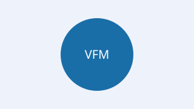
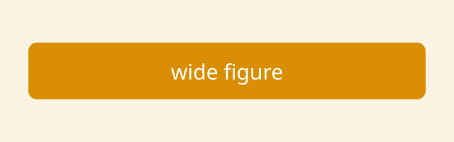

# Text beside a picture

@slide[Picture on the left](rtext)
- `rtext` puts the text on the right
- and the picture on the left

@end

@slide[Picture on the right](ltext)
- `ltext` puts the text on the left
- and the picture on the right

@end

# Two columns

@slide[Two columns of text](2col)
- Left column, first point
- Left column, second point
- Right column, first point
- Right column, second point
@end

@slide[Two pictures side by side](2col)

@end

@slide[A table fills the slide]
| Layout | Text goes | Pictures go |
| --- | :---: | :---: |
| `rtext` | right | left |
| `ltext` | left | right |
| `2col` | two columns | one per column |
@end
