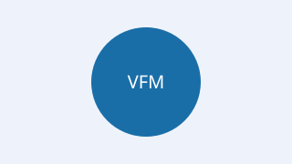

# Numbered things on slides

@slide[A figure with its reference](rtext)
Figure [@fig:disc] shows the disc.

 {#fig:disc}
@end

@slide[A reference to another slide is dropped]
This sentence points at [@fig:disc], which is on an earlier slide.
This sentence has no reference, so it stays.
@end

@slide[A table with a caption]
Sizes of the example decks. {#tab:sizes}
| Deck | Slides |
| --- | ---: |
| First slides | 5 |
| Layouts | 5 |
| Reveal steps | 3 |
@end

@slide[noxrefs drops every reference](noxrefs)
Table [@tab:sizes] is on the slide before this one.
This sentence has no reference, so it stays.
@end

@slide[An equation, numbered when cited]
$$
E = mc^2 {#eq:energy}
$$

Equation [@eq:energy] is the most famous one.
@end

@slide[Only in the talk](nodoc)
- This block is left out of the document
- so it is only ever seen as a slide
@end
